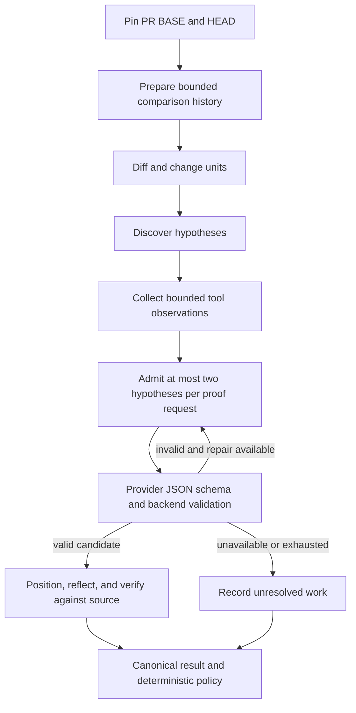

# Proof protocol reliability: implementation and validation

The original LiteLLM PR now completes the normal CLI protocol and produces a
partial COMMENT result. Its earlier malformed proof response no longer reproduces
in this run. This phase improves bounded execution, source preparation, and
observability. It does **not** establish reliable defect detection: an isolated
known-defect replay still fails final verification.

## Changes, one commit at a time

| Commit | Problem addressed | Implemented behavior | Validation at that commit |
| --- | --- | --- | --- |
| `46d2fbb` | Malformed proof ended analysis immediately | Proof-specific parsing, bounded repair, preservation of protocol errors and partial work | 671 full-suite tests |
| `c3ff797` | Output shape was only requested in prose; generation limits were opaque | Raw JSON-schema provider requests; explicit Ollama context; finish reason, truncation, schema digest, request limits and usage | 674 full-suite tests; native schema connection probe |
| `04373b0` | Several hypotheses and large tool dictionaries exceeded a small model's output budget | Typed batches of at most two hypotheses, exact identities and evidence references, one repair across the bundle, explicit deferred work | 686 full-suite tests; native SDK/HTTP contract test |
| `baa2b3c` | Shallow checkout lacked historical comparison objects | Prepare pinned BASE/HEAD and merge base before inference using bounded fetches; preserve target tip separately | 694 full-suite tests; real divergent shallow-repository integration |
| `726d24a` | Final finding verification still requested unconstrained text | Send final decision schema to provider; reject output reported as token-truncated even if it parses | 696 full-suite tests; native SDK/HTTP final-gate integration |
| `be9dcbd` | A provider failure without returned content could evade the per-bundle step count | Failed request attempts consume steps and retain a trace; exhausted work remains visible | 697 full-suite tests |

These are focused implementation commits. Their number is not a quality metric.
The final local suite was run on WSL/Python 3.12. Hosted contract tests separately
cover Windows/Linux and Python 3.11/3.12; check the workflow for the exact revision.

## What actually failed before

There were two separate failures in the pasted terminal session. PowerShell
backticks were used inside Bash, causing shell command substitution and an attempt
to execute review output. That shell error is independent of review quality.

A later normal CLI reproduction also failed inside the reviewer. Discovery
produced five hypotheses. The proof response copied a tool-result dictionary and
ended midway through JSON at its reported 1,400-token output limit. HTTP 200
established a completed HTTP request; it did not establish a valid review response.
The saved response is a regression fixture at
`tests/fixtures/proof-failures/litellm-53337.json`.

The checkout also lacked enough history for an immutable BASE/HEAD comparison.
That was a separate source-context problem. Neither failure justifies treating
the PR as clean, and neither means every planned project component was absent.

## Mechanism and boundaries



`core/agent/proof.py` creates a schema scoped to each batch's actual hypothesis
IDs. Every hypothesis must appear exactly once. A substantiated decision requires
a full candidate; other decisions must have a null candidate. Conclusive decisions
require admitted evidence references and cannot simultaneously declare missing
evidence. The candidate file must match its hypothesis. Backend code supplies the
bundle identity and source classification.

Evidence IDs identify tool observations. They do not guarantee that the model's
interpretation is correct. The proof writer's `disproved` outcome alone cannot
establish clean code or approval eligibility. Candidates still pass later gates.

The proof package clips long observations and records clipping, omits redundant
search-match detail, and lists observations omitted from its character budget.
Original observations remain available in the result. A package that exceeds the
prompt admission cap becomes unavailable rather than silently losing arbitrary
fields. This compaction is lossy; truncation cannot support a claim that a guard
or dependency is absent.

With four agent steps, one discovery call plus three batches can assess up to six
hypotheses when no repair is needed. A repair consumes a step and can defer a later
batch. One repair is available for the entire bundle. The shared review budget
also caps logical calls, prompt characters, and admission by elapsed time. Its
wall-time check occurs **between calls**, so an admitted request can exceed the
remaining wall budget; this is not a hard cancellation deadline.

`core/input/preparation.py` first tries existing Git objects. If needed, it fetches
the two complete commit hashes at depths 32, 128, and 512, with bounded command
timeouts and a 90-second preparation budget. It never unshallows the whole repo
or changes the working tree. Failure remains an explicit context limitation.
The target branch tip stays in `base_sha`; source comparison uses the merge base.
The runtime checks the prepared revision and review-diff identities before use.

The default Ollama context is now explicitly 8,192 tokens, configurable through
`OLLAMA_CONTEXT_TOKENS` or `ollama_context_tokens` in user configuration. A larger
context consumes more KV-cache memory. This setting is part of the measured
profile, not a promise that every PR fits on the local GPU. Proof and final-gate
requests use a 1,400-token output cap. Discovery remains a text protocol.
Character admission caps are not exact tokenizer-based context guarantees.

The Ollama path was exercised with the installed provider, SDK, HTTP transport,
and live local model. The optional OpenAI adapter was updated but was not exercised
against a cloud service in this phase. No cloud inference cost was incurred or
measured. Recorded zero estimated cost does not measure electricity or hardware.

## Live normal CLI result

Frozen clean reviewer: `baa2b3c3522958dad54aa556399e7f10251037a9`.
Public development PR: `BerriAI/litellm#53337`, with frozen HEAD and target BASE
assertions. The full target identities and raw outputs are preserved in
[the artifact](validation/proof-reliability-v1/litellm-v1.json).

| Observation | Result |
| --- | --- |
| CLI exit | 0 |
| Recommendation / health | COMMENT / partial |
| Actual model requests | 3: discovery plus two schema-bound proof requests |
| Proof batches | Both completed; no repair needed |
| Reported prompt / completion tokens | 6,755 / 2,046 |
| Review wall time | 164.81 seconds |
| Recorded process inspection | 3/3 units |
| Unresolved records | 7 |
| Product findings / publication | 0 / none |
| Source preparation | Recovered comparison after depths 32, 128, 512 |

The model produced three weak hypotheses, including descriptions of an intentional
repair and its new test. It generated two candidates: one was dropped as a note;
the other failed the snippet/hunk gate. The model's structurally valid output was
not semantically useful enough to establish a clean result. A missing graph and
incomplete tool observations also remained visible.

This is one integration smoke on a development PR. Do not describe 3/3 process
inspection as defect recall, zero findings as a correct clean verdict, or the wall
time as a latency percentile. The changed context and differing model-generated
hypotheses prevent an accuracy or speedup claim against the earlier failure.

## Isolated final-gate checks

Frozen clean reviewer: `be9dcbdd039ab2cc90460708cc2a9a17b6648197`.
These checks supply a fixed candidate to isolate final verification. They bypass
discovery and do not demonstrate end-to-end detection. Both cases are synthetic
and author-defined; they are not independently adjudicated held-out PRs.

| Case | Author expectation | Actual outcome | Requests | Wall seconds |
| --- | --- | --- | ---: | ---: |
| Removed None guard | Support concrete TypeError defect | Invalid refutation rejected; unresolved after repair | 2 | 27.16 |
| Preserved None guard | Refute the fixed defect claim | Model abstained; unresolved | 1 | 9.69 |

All three responses were complete JSON with provider finish reason `stop`.
However, the removed-guard response still reasoned from BASE protection and
claimed HEAD would return zero. It supplied no counter-citations for its refuted
verdict. Backend validation rejected both attempts. The preserved-guard response
selected unresolved without citations. Neither case met its conclusive target.

This preserves a known false negative rather than hiding it behind schema success.
The schema constrains structure; it cannot establish correct Python semantics or
force a truthful verdict. No detection improvement is demonstrated here.

The [manifest](validation/proof-reliability-v1/manifest.json) identifies profiles,
commits, limits, and SHA-256 hashes for raw artifacts. The saved
[replay script](validation/proof-reliability-v1/replay_final.py) uses the same replay
algorithm with a configurable output directory. Run from the chosen frozen clean
reviewer checkout, using its Python environment and a reachable Ollama service:

```bash
PYTHONPATH=. /home/venkat/projects/CodeTurtle/.venv/bin/python \
  /home/venkat/projects/CodeTurtle/docs/validation/proof-reliability-v1/replay_final.py
```

Choose a fresh `CODETURTLE_DIAGNOSTIC_OUTPUT` directory for repetitions. The script
creates local synthetic Git commits, makes real model requests, and preserves
per-case outcomes. Repeated cases are repeated observations, not new benchmark PRs.

## Next implementation order

1. Complete immutable PR investigation tools and scoped source capture. The new
   snapshot currently prepares final verification; it does not migrate every
   checkout-based rule/tool. Whole-file capture still truncates ordinary large
   files. A function excerpt must declare its scope and unresolved dependencies;
   it cannot be relabeled as complete repository context.
2. Improve final decision quality using frozen candidate replays. Separate JSON
   shape, cross-field consistency, citation correctness, semantic correctness,
   abstention, repairs, and cost. Evaluate backend-resolved citation ranges and a
   stronger local/cloud model under explicit resource limits. Preserve failed
   attempts; do not tune against a supposedly held-out set.
3. Implement explicit defective/clean/uncertain benchmark labels, false-MERGE
   denominators and confidence intervals. Missing reference comments do not imply
   clean code. A reviewer that abstains on everything also needs usefulness metrics.
4. Assemble and adjudicate the real-PR pilot, freeze reviewer/model/configuration,
   and run baselines before making resume accuracy claims. Durable task recovery,
   incremental re-review, and release qualification remain separate later work.

Current portfolio evidence supports typed contracts, bounded model orchestration,
real failure replay, immutable final source identity, test coverage of failure
handling, and an auditable live integration. It does not support a completed 2.0
release, arbitrary-PR reliability, high recall, or a low false-MERGE rate.
